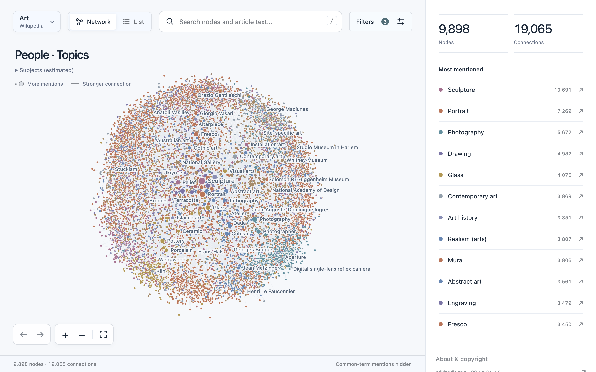
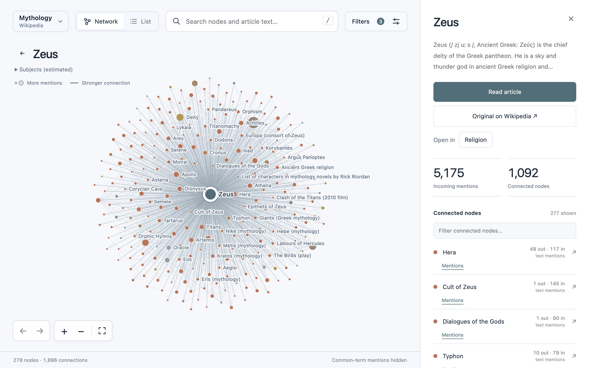

<h1 align="center">Plato Explorer</h1>

<p align="center">
  Explore how encyclopedia articles mention people and ideas.<br />
  Each realm is a network you can search and read.
</p>

<p align="center">
  <a href="https://plato-network.pages.dev/">
    
  </a>
</p>

<p align="center">
  <a href="https://plato-network.pages.dev/?realm=art">
    
  </a>
</p>

## Realms

| Realm                                                                     | Source                                              |
| ------------------------------------------------------------------------- | --------------------------------------------------- |
| [Philosophy](https://plato-network.pages.dev/?realm=philosophy-wikipedia) | Wikipedia                                           |
| [Psychology](https://plato-network.pages.dev/?realm=psychology)           | Wikipedia                                           |
| [Economics](https://plato-network.pages.dev/?realm=economics)             | Wikipedia                                           |
| [Society](https://plato-network.pages.dev/?realm=society)                 | Wikipedia                                           |
| [Religion](https://plato-network.pages.dev/?realm=religion)               | Wikipedia                                           |
| [Mythology](https://plato-network.pages.dev/?realm=mythology)             | Wikipedia                                           |
| [Art](https://plato-network.pages.dev/?realm=art)                         | Wikipedia                                           |
| Philosophy                                                                | Stanford Encyclopedia of Philosophy (not published) |

A node found in several realms links to the others. [Realms](docs/realms.md)

The explorer was first built for the Stanford Encyclopedia of Philosophy (SEP). The published app has the Wikipedia realms only. The SEP's terms do not allow its entries to be republished on a public website, so the SEP realm is not published. To explore it, [build it locally](#run-locally).

## Select a node

Larger nodes receive more mentions. Thicker lines mean more mentions between a pair. The sidebar lists a node's connections with the mentions in each direction.



## Read the mentions

Choose **Mentions** beside a connected node to see the passages behind the connection. Selecting a passage opens the article at that sentence.


## Search the full text

Search covers node names and the text of every article in the realm.


The brief excerpts in these screenshots are from English Wikipedia, by Wikipedia contributors, under [CC BY-SA 4.0](https://creativecommons.org/licenses/by-sa/4.0/). [Zeus](https://en.wikipedia.org/wiki/Zeus) · [Carl Jung](https://en.wikipedia.org/wiki/Carl_Jung) · [Moral panic](https://en.wikipedia.org/wiki/Moral_panic) · [Elite panic](https://en.wikipedia.org/wiki/Elite_panic) · [Satanic panic](https://en.wikipedia.org/wiki/Satanic_panic)

## Run locally

Use Python 3.12 or newer. These commands download about 271 MB and build the SEP Philosophy realm.

```sh
python3 -m venv .venv
. .venv/bin/activate
python -m pip install -r requirements.txt
python scripts/fetch_source.py
python scripts/build_data.py
python scripts/build_search.py
python scripts/serve.py
```

Open `http://127.0.0.1:5173` in your browser.

The Wikipedia realms need a 35 GB Wikipedia snapshot. [Wikipedia sources and build steps](docs/wikipedia-realms.md)

## Made with AI

The explorer code, matching rules and documentation were generated almost entirely by AI coding agents, directed by the author. Mentions are matched automatically and subjects are estimated, so connections can be wrong or missing.

## Copyright

The explorer code and documentation are dedicated to the public domain under CC0 1.0, without warranty. The repository contains no SEP articles, Wikipedia articles or generated corpus files. Wikipedia text is available under CC BY-SA 4.0. SEP entry authors generally retain copyright in their articles. Plato Explorer has no affiliation with Stanford University, the SEP or the Wikimedia Foundation. [CC0 1.0](LICENSE) · [Copyright notice](COPYRIGHT.md)
