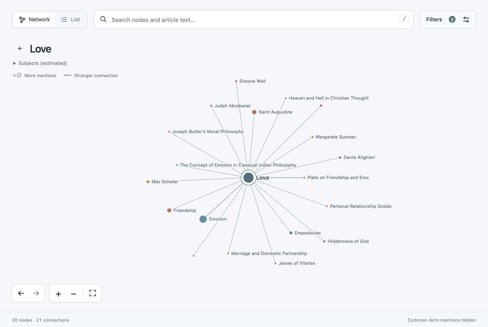
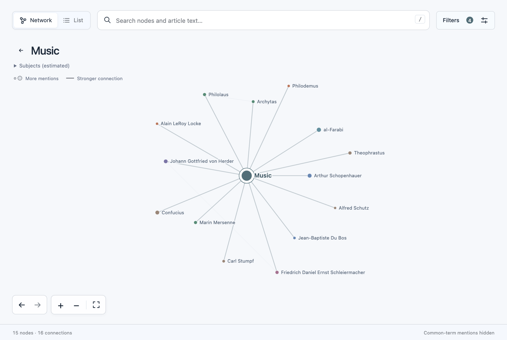

# Plato Explorer

A web browser for the Stanford Encyclopedia of Philosophy article network.

The project code is licensed under the [MIT License](LICENSE).

**Copyright and data.** This repository contains the explorer's source code, tests, matching rules, and interface screenshots. It includes no Stanford Encyclopedia of Philosophy corpus, article text, generated graph files, or search index. Entry authors generally retain copyright in their articles, and the Metaphysics Research Lab at Stanford University holds copyright in the encyclopedia. The SEP terms limit redistribution. [Copyright notice](COPYRIGHT.md) · [SEP terms of use](https://plato.stanford.edu/info.html#terms)

For a new thread, start with the [project handoff](docs/handoff.md) and [agent instructions](AGENTS.md). The handoff indexes the technical guides and records the decisions behind the current app.

## Screenshots

**Love** connects friendship and emotion with entries on Dante, Saint Augustine, and Simone Weil. This view shows pairs with at least 32 mentions.



**Music**, with the People filter selected, shows whose biographies mention music. Confucius, Arthur Schopenhauer, and al-Farabi appear together here.



## Run

On a fresh clone, follow [Rebuild the data](#rebuild-the-data) first. Once the graph and search index are present in `web/data/`, start the local server.

```sh
npm start
```

The server uses Python's standard library. After building the data, the preview runs locally without API keys or a database. The hosted app is a separate Cloudflare Pages deployment. [Local preview](http://127.0.0.1:5173) · [Hosted app](https://plato-network.pages.dev) · [Deployment guide](docs/public-deployment.md)

To use a different port:

```sh
python3 scripts/serve.py --port 5174
```

## Use

- On iPhone, open the public site in Safari, choose **Share → Add to Home Screen**, enable **Open as Web App** if shown, then tap **Add**. The **Plato** icon opens the app in a standalone window. An internet connection is required to load the graph and articles.
- Search titles, curated philosopher aliases, and the full text of all articles. Title results explore the graph; text results open matching passages. All query words must appear somewhere in the article (case and accents are ignored). Text search is independent of graph filters. Press `/` to focus search; use arrow keys and Enter to choose a result.
- **People**, **Topics**, and **Keywords** are independent filters. People includes biographies and mentioned people without a dedicated article. Keywords start hidden. The selected node always stays at the centre, even when its type is unchecked. **Colour by** offers estimated subjects, node type, connection count, or neutral colours.
- Select a node, then **Shift-click** a connected node to see the matching sentences in both directions. The details panel **Mentions** buttons provide the same action for touch and keyboard. Related-entry links appear separately. Open a passage to highlight its exact sentence and matching mentions in the article.
- Click a node to focus its immediate neighbors. The graph also retains connections between those neighbors.
- Hover over a node to see an **Article**, **Keyword**, or **Person** badge. Person identifies someone mentioned without a dedicated article in this snapshot.
- **Hide common-term mentions** is enabled by default. It excludes inferred mentions of terms appearing in more than half the articles, including Time, Object, Truth, Life, and Existence. It preserves explicit related-entry links and outgoing mentions of other articles. Open **Filters** to inspect the list or restore all mentions.
- Node size increases with incoming text mentions from other articles after applying the common-term filter. Line thickness increases with the sum of mentions in both directions. Related-entry links without text mentions are dashed in focused views.
- The details panel lists combined connection strength, with separate outgoing and incoming mention counts. “Related entry” is independent of those counts.
- Minimum mentions defaults to **5** to reduce the number of drawn edges. **Show weaker connections** lowers it to 1 without clearing the selected node. A dismissible Firefox notice explains the potential rendering slowdown.
- Use **Filters** to choose a connection type and minimum mention count. The threshold uses the sum of mentions in both directions. To see pairs linked solely by an editorial related entry, choose **Related entries** or set **All connections** to a minimum of 1.
- Drag to pan, scroll or pinch to zoom, and use the fit button to reset the view. With the canvas focused, arrow keys pan, `+`/`−` zoom, and Home fits the view.
- **List** provides an accessible alternative to the canvas. Selecting a node returns to its network.
- Nodes without articles show mentioning articles and exact passage evidence; they do not invent article content or original URLs. Search for **Music**, **Aestheticism**, or **Carl Jung** to explore examples.
- **Read article** opens the introduction, sections, bibliography, and related entries. On mobile, tap **Contents** to browse the section list. **Close** returns to your reading position. Choosing a section jumps there, and **Back** returns to the previous passage. Coloured mentions open the corresponding network; a faint underline appears on hover or keyboard focus. **Original on SEP** opens the live article.
- On mobile, the graph fills the screen. **Details** opens a full-screen panel; **Back to graph** returns to the graph. The Details footer follows the connections in the scrolling content. **Filters** also opens full screen, and the legend button sits beside the zoom controls.
- The selected node is recorded in the URL, such as [Nietzsche](http://127.0.0.1:5173/#/nietzsche). Browser Back/Forward and the graph's navigation buttons restore selections, evidence, readers, panels, filters, camera position, and scroll positions. Reader contents links are included in this history.

## Rebuild the data

Use Python 3.12 or newer for the pinned PyArrow and NumPy dependencies. To build a local copy, review the publisher's terms first. The download command fetches the Parquet file from a pinned revision of the unofficial Hugging Face dataset and saves it to `data/good-one.parquet`. If you already have the matching file there, proceed directly to the build commands. [Dataset card](https://huggingface.co/datasets/hugfaceguy0001/stanford_plato) · [Copyright and permitted uses](COPYRIGHT.md)

```sh
uv venv --python 3.12 .venv
uv pip install --python .venv/bin/python -r requirements.txt
.venv/bin/python scripts/fetch_source.py
.venv/bin/python scripts/build_data.py
.venv/bin/python scripts/build_search.py
```

With a suitable Python installation, you can use `python3 -m venv .venv` and `.venv/bin/python -m pip install -r requirements.txt` in place of the two `uv` commands.

The default input is `data/good-one.parquet`. The script writes `web/data/graph.json`, `web/data/build-report.json`, and one JSON file per article under `web/data/articles/`. Individual article files load only when opened. The sharded full-text index adds about 30 MiB and loads only the shards needed by a query.

Optional arguments:

```sh
.venv/bin/python scripts/build_data.py --source data/good-one.parquet --output web/data
```

The primary snapshot contains **1,776 articles**. Generated graph and mention totals are recorded in `web/data/build-report.json`. The build uses one snapshot for article text and related entries to avoid mixing revisions. For author credits, the builder can also read an optional `stanford-encyclopedia-of-philosophy_dec23.jsonl` alongside the Parquet file. The fetch script downloads only the primary snapshot. When a credit is unavailable, the reader displays the general author copyright notice and links to the original SEP entry.

To adjust article matching, edit `scripts/aliases.json` and rebuild. `scripts/mention_rules.json` controls known ambiguous names and competing identities. `scripts/extra_nodes.json` curates additional people and keywords. Every accepted extra node must occur in at least two source articles and must not duplicate an existing title or alias. The build writes a frequency table for every normalized word to `web/data/word-frequencies.json`, plus accepted/rejected candidate evidence in `web/data/keyword-report.json`. See [the link audit](docs/link-audit.md) for the corpus-wide validation command.

## Validation

```sh
npm run check
npm test
```

Tests cover matching boundaries, longest-title precedence, aliases, self-mention exclusion, Unicode link offsets, graph filters, common-term suppression, search, URL/data validation, and directionality. Corpus checks read all generated articles and verify that every graph mention is supported by a reader link, and every related-entry edge is preserved. Corpus tests skip when generated data is absent; rebuild first to include them.

Browser checks covered desktop and mobile layouts, keyboard search, article loading, linked mentions, original URLs, contents navigation, filtering, list mode, browser history, pan/zoom, and error states.

Navigation stores live scroll and camera positions in memory, persists them to session storage after scrolling pauses, and flushes pending positions on navigation or page exit. Browser history is written only for navigation, avoiding WebKit's history API rate limit during continuous scrolling. Back, Forward, and reload restore the latest saved positions.

## Project structure

```text
data/                    Local source inputs (ignored by Git)
scripts/fetch_source.py  Download the primary snapshot for a local build
scripts/build_data.py    Source validation, article extraction, graph generation
scripts/text_processing.py   Shared text normalization and mention matcher
scripts/layout.py        Deterministic community grouping and force layout
scripts/aliases.json     Curated short names and spelling variants
scripts/mention_rules.json   Ambiguous-name and competing-identity rules
scripts/extra_nodes.py    Corpus word frequencies and additional node validation
scripts/extra_nodes.json  Reviewed keyword and missing-person candidates
scripts/audit_links.py    Full-corpus link validation and baseline comparison
scripts/people.json      Reviewed biographical article IDs
scripts/categories.py    Approximate subject classification
scripts/build_search.py  Static full-text index generation
scripts/serve.py         Local static server, restricted to web/
scripts/deploy_public.py  Verified static upload to Cloudflare Pages
web/app.js               Search, navigation, controls, and details panel
web/navigation.js        Validated browser history and complete view restoration
web/graph-view.js        Canvas rendering, picking, pan/zoom, and layouts
web/data-model.js        Data validation, indexing, search, and graph filtering
web/reader.js            Safe article rendering and navigation
web/evidence.js          Exact matching passages between articles
web/full-text-search.js  Sharded full-text retrieval and excerpts
web/account.js           Previous private deployment's account UI (not published)
worker/                 Previous private deployment's asset gate and Google OAuth
web/data/                Generated articles, graph, reports, and search index (ignored by Git)
tests/                   JavaScript and Python tests
docs/data-model.md       Data contracts, methodology, and limitations
```

The interface uses native JavaScript modules, Canvas, CSS, and system fonts. Local preview and public Cloudflare Pages hosting serve static files. The public app has no Worker functions, authentication, or database queries. [Public deployment instructions](docs/public-deployment.md) describe the explicit upload allowlist and crawler directives. The [previous private Worker documentation](docs/deployment.md) is retained separately. [Search documentation](docs/search.md) explains indexing and request costs.

## Source and limitations

The dataset supplies article URLs and section structure. The reader displays plain text and retains available attribution. Source formatting, equations, footnotes, or text missing from the snapshot may be missing in the reader. Use **Original on SEP** for the publisher's version.

The reader and **About & copyright** panel show attribution. The hosted app uses crawler directives to request exclusion from indexing. Public files remain accessible. [Copyright notice](COPYRIGHT.md)

Matching is deliberately lexical. A mention is not necessarily a citation, endorsement, or semantic relationship. Common article titles such as “Time,” “Life,” and “Truth” therefore receive many matches. Only reviewed aliases are added; paraphrases and unconfigured synonyms are not inferred. Accent and Unicode-hyphen variants match while preserving original article text. Competing identities in the text or bibliography can suppress an ambiguous short name for that source article. Subject colours are estimates from titles, introductions, and related-entry titles, not official SEP categories. People classification uses a reviewed list in `scripts/people.json`. Layout positions use the connections after removing common-term noise. See [the data model](docs/data-model.md) for details.
