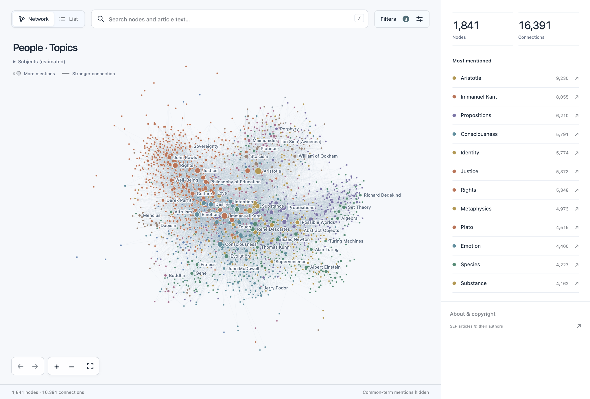

# Plato Explorer

Explore how articles in the Stanford Encyclopedia of Philosophy mention people and ideas. Larger nodes receive more mentions. Thicker lines mean more mentions between a pair. You can also search the full text and read articles in the explorer.



With all node types and common terms included and the minimum set to one mention, **Love** has 624 neighbours, from _Friendship_ to _Saint Augustine_. Select it to see how often the articles mention each other and which ones the SEP lists as related entries.


Select **Music**, find **Confucius** in the sidebar, and choose **Mentions**. The 18 results each open the Confucius entry at the highlighted sentence. The screenshot shows the matched words and omits the surrounding article text.


## Run locally

From a clone of this repository, use Python 3.12 or newer. The download is about 271 MB. One snapshot supplies the articles and their related entries. The other supplies author credits. [Article dataset](https://huggingface.co/datasets/hugfaceguy0001/stanford_plato) · [Author credit dataset](https://huggingface.co/datasets/dmarx/stanford-encyclopedia-of-philosophy_dec23)

```sh
python3 -m venv .venv
. .venv/bin/activate
python -m pip install -r requirements.txt
python scripts/fetch_source.py
python scripts/build_data.py
python scripts/build_search.py
python scripts/serve.py
```

Open `http://127.0.0.1:5173` in your browser.

## Copyright

The repository contains no SEP articles or generated corpus files. Entry authors generally retain copyright in their articles. The Metaphysics Research Lab at Stanford University holds copyright in the encyclopedia. The MIT license covers the explorer code. [MIT license](LICENSE) · [Copyright notice](COPYRIGHT.md) · [SEP terms of use](https://plato.stanford.edu/info.html#terms)
